# System design: wearable meeting agent

## 1. Context and scope

One wearable device, on a body, in a room, records conversations when the wearer starts it. The system turns that audio into summaries that say who committed to what. That needs two things: diarization (who spoke when) and speaker identification (which real person each voice is, recognized again across conversations).

There is no meeting platform, no participant list and no per-speaker audio. The audio is far-field and noisy, the wearer is inches from the microphone while everyone else is across a table, the device is sometimes offline for hours, and the other people never installed anything. Voiceprints are biometric data.

### Assumptions

These are not stated in the assignment. Each one is a choice we made, and the design depends on it.

- **A1.** The wearable reaches the phone over Bluetooth Low Energy. Wi-Fi may be available for large backlogs.
- **A2.** The wearable has a small processor that can run voice activity detection and audio compression, but not speech-to-text or diarization.
- **A3.** The wearable stores at least 9 hours of audio. As Opus at about 24 kbps, that is about 100 MB.
- **A4.** Each device has one wearer, who has an account and can enroll their own voice.

## 2. Goals and non-goals

Goals:

- Attribute every line to a named person, or to a stable "Unknown speaker" label that the wearer can name later.
- Recognize the same person across conversations and settings.
- Lose no audio during offline periods.
- Treat voiceprints as biometric data: consent, encryption and deletion.

Non-goals:

- Live transcription. Processing is batch, after the recording ends (decision D4).
- A user interface.
- Training or fine-tuning models.

## 3. Design

### 3.1 Container diagram

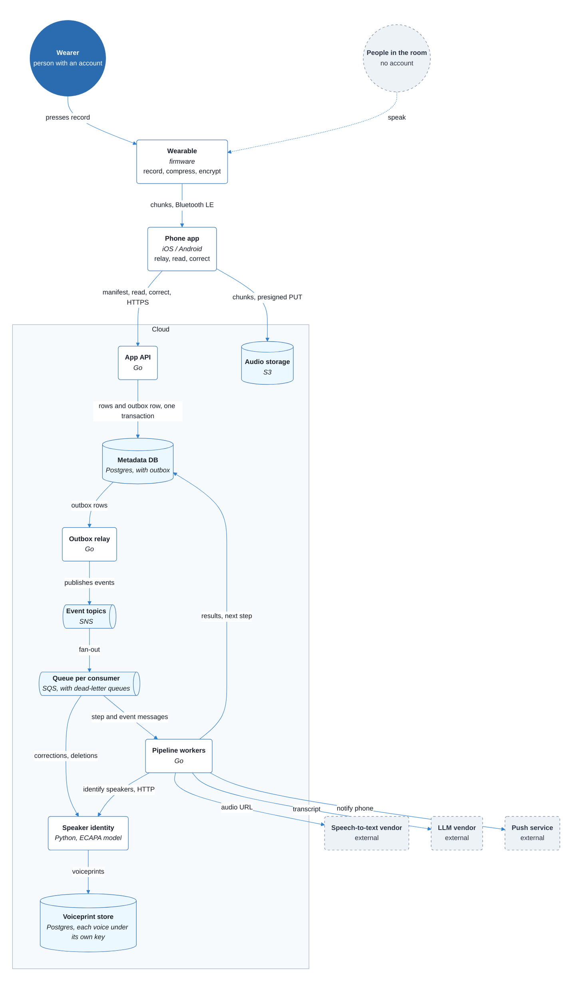

Key: solid circle is a person with an account, dashed circle is a person without one. Rounded boxes are our services, cylinders are data stores, and dashed gray boxes are external vendors. Solid arrows are calls or data flow, labeled with what moves and the protocol. All calls to external vendors use HTTPS. The dashed arrow means people are recorded without using the system.

### 3.2 Where each part runs

**D1. The wearable records, drops long silences, compresses, encrypts and chunks.** After a long offline period, transfer speed is the constraint, not storage, so sending less audio matters. The silence filter keeps padding around speech, because missing a quiet word costs more than uploading silence. Encryption protects recordings on a lost device (scenario 6).

**D2. The phone is a relay.** It pulls chunks from the wearable, uploads them, and keeps nothing.

**D3. Buy speech-to-text and diarization, build speaker identity, buy the language model.** Speaker identity runs on an off-the-shelf embedding model inside our own systems, so no third party stores voiceprints and deletion stays fully in our control.

**D4. Batch processing only.** Processing after the recording ends sees the whole conversation, which makes clustering and identification more accurate. Live transcription is a separate path that can be added later.

### 3.3 Data model

Entity-relationship diagrams in crow's foot notation. At each end of a line, a bar means one and a three-pronged foot means many, and a circle in front means it can also be zero: two bars is exactly one, circle and bar is zero or one, circle and foot is zero or more, bar and foot is one or more. When a table marks several columns PK, together they are the primary key: `CHUNK` has one row per `(recording_id, chunk_number)`. The metadata DB is drawn in two parts; `USER` and `RECORDING` show their columns in the first.

Metadata DB (Postgres), recordings and upload:

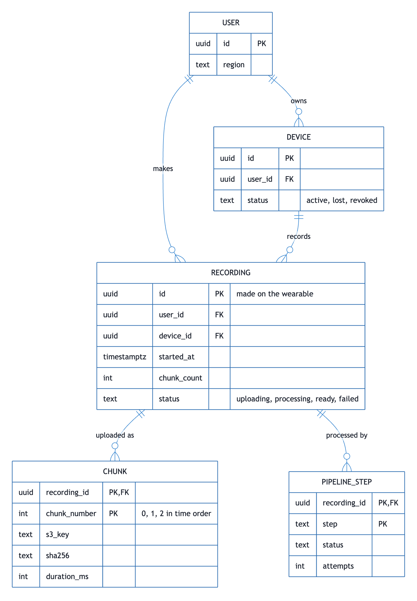

Metadata DB, transcript and speakers:

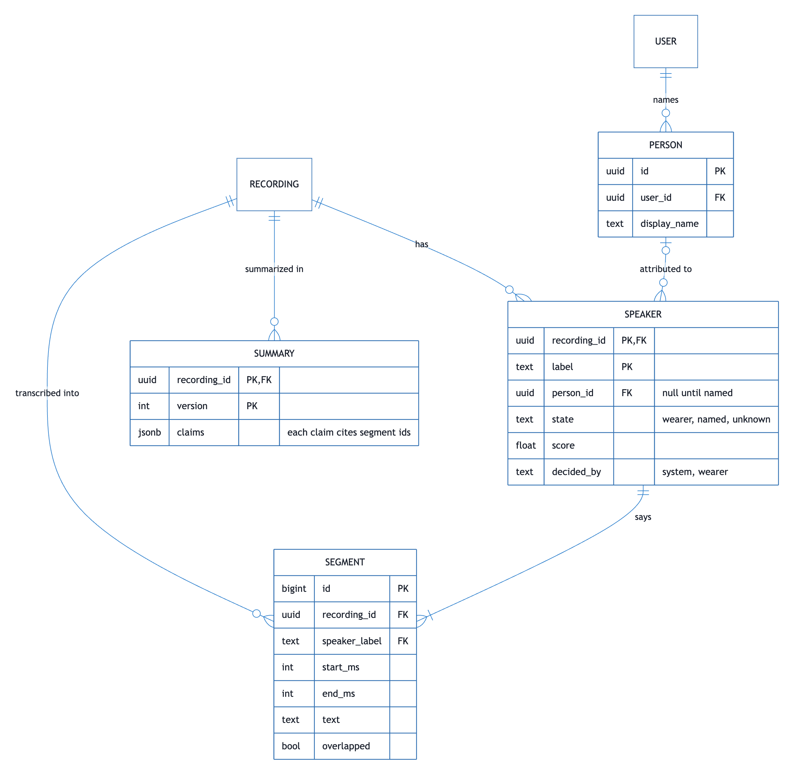

Voiceprint store (Postgres, owned by the speaker identity service):

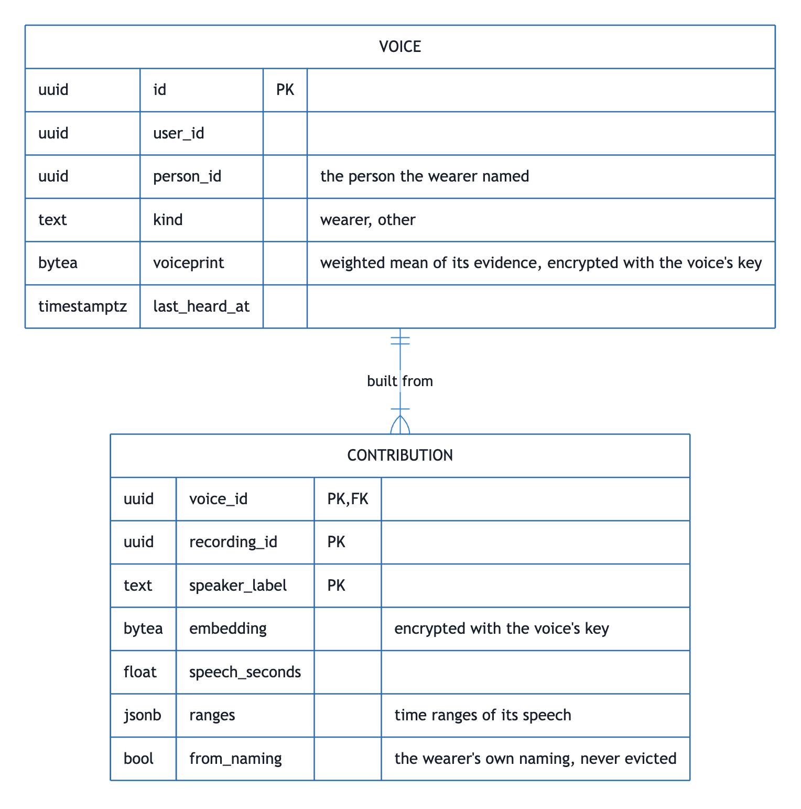

- **Ids come from the wearable.** The recording id and chunk number exist before any upload, so every upload and retry is idempotent on `(recording_id, chunk_number)`.
- **People belong to one wearer.** There is no person shared across accounts. Two wearers who both meet Priya have two unrelated Priyas, so the system never builds a cross-user graph of people who did not sign up.
- **A speaker is one diarization label in one recording,** such as the vendor's `A` or `B`. Labels start again in every recording, so `SPEAKER` has one row per `(recording_id, label)`. The identity service or the wearer attributes it to a person. `decided_by` records which, and a wearer's decision is never overwritten by a re-run.
- **Transcripts live in two forms.** The vendor's raw output, every word with its time and label, is one JSON file per transcript version in S3. Postgres keeps one `SEGMENT` row per speaker turn, with its text and times. Summaries cite segments, and the app shows them. Chunks are only for transfer, so a segment can cross a chunk boundary.
- **Raw audio is deleted 30 days after processing.** That window covers re-processing and late corrections. Transcripts and summaries stay until the wearer deletes them.
- **Voice evidence points back to its recording.** Each `CONTRIBUTION` row stores the recording, speaker label and time ranges it came from. Deleting a recording, cutting a part of it or correcting a label moves or deletes exactly the rows it touches, and the voiceprint is recomputed from the rest.
- **Outbox.** The API and the workers write each event to an `OUTBOX` table in the same transaction as the change, and the outbox relay publishes it to SNS, so an event is never lost and never sent for a change that did not happen.

### 3.4 Interfaces between components

**Wearable and phone (Bluetooth LE, or Wi-Fi for large backlogs).**

| Operation | Content | Notes |
|---|---|---|
| list | manifest entries: recording id, chunk number, start time, duration, SHA-256 | the phone asks right after it connects |
| read | one encrypted chunk | resumes chunk by chunk after a dropped link |
| confirm | recording id, chunk number | sent only after the cloud confirms; only then does the wearable delete the chunk |

**Phone and App API (HTTPS, JSON).**

| Endpoint | Purpose |
|---|---|
| `POST /v1/recordings` | create the recording row, with the id the wearable made, before its chunks upload; repeating it is harmless |
| `POST /v1/recordings/{id}/chunks/{number}/upload-url` | presigned S3 PUT URL for a key that ends in the chunk's SHA-256, valid only if no object exists there yet |
| `POST /v1/recordings/{id}/chunks/{number}/complete` | check the device signature, read the object's size and checksum from S3, then record the chunk; a repeat with the same hash is a no-op; only then does the phone send confirm to the wearable |
| `POST /v1/recordings/{id}/finalize` | declare the chunk count; once all chunks are present, emit `recording.uploaded` |
| `GET /v1/recordings/{id}` | status, segments, speakers and summary |
| `PUT /v1/recordings/{id}/speakers/{label}` | wearer names a speaker, picks another person, or says "not this person" |
| `POST /v1/recordings/{id}/redactions` | remove a time range that should not have been recorded (scenario 2): its audio, transcript and voice evidence |
| `DELETE /v1/recordings/{id}`, `/v1/people/{id}`, `/v1/me` | delete one recording, one person (name and voiceprint), or the whole account |
| `POST /v1/devices/{id}/revoke` | mark a lost device; its key stops being accepted |

**Events (outbox, SNS topic, one SQS queue per consumer).** Every event carries `event_id`, `type`, `user_id`, `recording_id`, `occurred_at` and `schema_version`. Delivery is at least once and in no guaranteed order: consumers ignore an `event_id` they have already handled, and every deletion leaves a tombstone, a small record that says the data was deleted, which later writes check (diagram in scenario 2).

| Event | Consumers |
|---|---|
| `recording.uploaded` | pipeline (start transcription) |
| `step.done` | pipeline (start the next step) |
| `summary.ready` | push notification |
| `speaker.corrected` | speaker identity (update voiceprints, under the per-wearer lock in section 4.3), pipeline (re-attribute affected summaries) |
| `deletion.requested` (a recording, a person, the account, or a cut part of one recording) | every owner of that data: audio, metadata, voiceprints, vendor deletion requests |

**Pipeline workers and speaker identity (internal HTTP).**

| Endpoint | Purpose |
|---|---|
| `POST /identify` | input: user id, recording id, the S3 key of the assembled plaintext audio, and each diarization label with its time ranges. Output per label: `wearer`, `named` or `unknown`, with person id, score and margin |

**Processing one recording.** Each step is idempotent on `(recording_id, step)` and ends with `step.done`, which starts the next step through the queue.

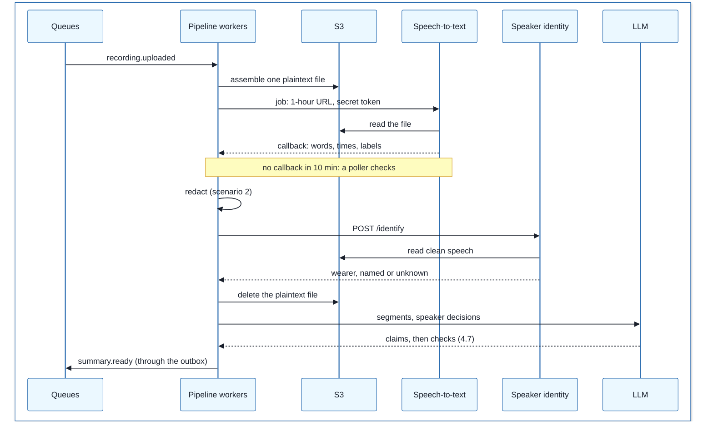

### 3.5 Failure modes

| Part | Failure | What happens |
|---|---|---|
| Wearable | storage full | it never overwrites unsynced audio; it stops recording and tells the wearer with a light and a vibration |
| Bluetooth link | drops mid-transfer | the phone resumes at the next unconfirmed chunk; chunks are idempotent on `(recording_id, chunk_number)` |
| Phone app | killed by the OS, or no network | audio stays on the wearable, which deletes nothing unconfirmed; transfer resumes on the next connection |
| Upload | presigned URL expires, or the network fails | the phone asks for a new URL and retries with backoff; S3 checks the checksum |
| Upload | the same chunk arrives twice | same hash: no-op; a different body goes to a different key, because the key ends in the hash, so it can never overwrite the confirmed chunk; `complete` rejects it and alerts, since it means a device bug |
| Finalize | a chunk is missing | the recording stays in `uploading` and the app asks the wearable for that chunk; after 7 days it is processed with a marked gap |
| Outbox relay | down | events wait in the outbox and are delayed, not lost |
| Worker | crashes mid-step | the SQS message becomes visible again and another worker retries; each step is idempotent on `(recording_id, step)` |
| Any consumer | message fails 5 times | it moves to that consumer's dead-letter queue, an alert fires, and it can be replayed after a fix |
| Speech-to-text vendor | outage or slow | retries with backoff; the app shows "processing" until it succeeds |
| Speech-to-text vendor | webhook lost | the poller finds the finished job |
| Speaker identity | down | the pipeline continues with "Unknown speaker 1, 2" labels and marks attribution pending; a later `identify` run fills in names and the summary is rebuilt |
| LLM vendor | outage | the transcript is shown without a summary; the summary step retries |
| Postgres | primary fails | Multi-AZ failover; writes fail for under a minute and callers retry |

Reconnecting after a long offline period (scenario 3):

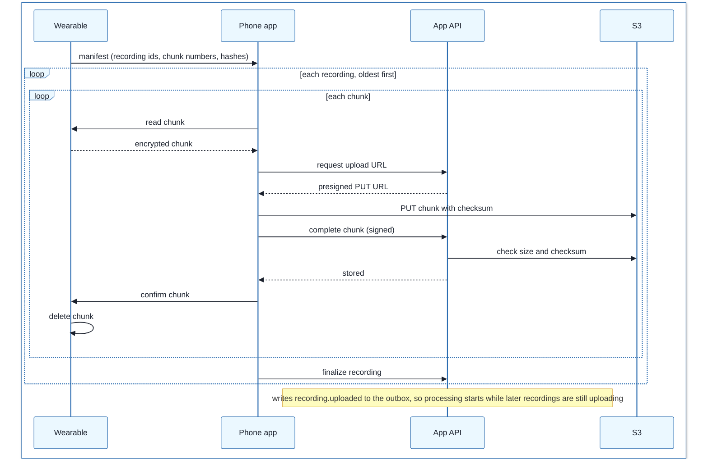

### 3.6 Scale and cost

Planning load: 100,000 wearers recording 1 hour of speech a day each (after silence removal), so 100,000 recorded hours a day. Peak hours run at about 3 times the average.

| Path | Load at peak | Fits because |
|---|---|---|
| Chunk uploads | about 420 chunks per second (30-second chunks) | S3 takes them directly through presigned URLs; the API writes one small row per chunk |
| Pipeline messages | about 100 per second (about 20 per recording) | well inside one SQS queue's limits |
| Segment rows | about 2,000 inserts per second, 60 million rows a day | the largest table: batch-insert per recording, partition by month |

Cost per recorded hour, at list prices:

| Item | Basis | Per hour |
|---|---|---|
| Speech-to-text with diarization and word timestamps | batch rate, about $0.21 per hour (AssemblyAI; Deepgram Nova-3 about $0.26) | $0.21 |
| Summary | Claude Sonnet 5.5, about 12,000 input and 2,000 output tokens at $2 and $10 per million, plus a claim check on Claude Haiku 5.5 | $0.046 |
| Speaker identity and overlap detection | CPU only, no GPU | negligible |
| Audio storage | about 11 MB for 30 days at $0.023 per GB-month | under $0.001 |
| Queues, notifications, database | shared, small per hour | about $0.005 |
| **Total** | | **about $0.26** |

At planning load that is about $26,000 a day. Speech-to-text is about 80% of it, so the levers in order are:
- **Send less audio.** Every silent minute the wearable drops is a minute not billed.
- **Self-host speech-to-text** (for example WhisperX with pyannote on GPUs) once volume justifies a GPU fleet.

## 4. Deep dive: speaker identity service

This service puts names on speakers, so a summary can say "Priya committed to the 14th".

A wrong name is worse than no name, because the wearer trusts it and acts on it (scenario 7).

So the service is built precision first, with two rules:
- **It names only people the wearer has named before.** It never builds a voiceprint for someone the wearer did not name.
- **It shows a name only when the evidence is strong.** Our goals:
  - At most 1 wrong name in every 100 names shown.
  - At most 1 stranger in 100 gets a name by mistake. A stranger is anyone the wearer never named, such as a waiter.
  - Anything unclear shows as "Unknown speaker". The wearer can name it in one tap.

### 4.1 Inputs and outputs

The pipeline calls `POST /identify` once per recording (section 3.4), before the plaintext audio is deleted. The request lists every diarization label with the time ranges, in seconds, where it speaks:

```json
{
  "user_id": "u_17",
  "recording_id": "42",
  "audio": "s3://.../plain/42.opus",
  "labels": {
    "A": [[0.0, 8.2], [15.1, 40.7]],
    "B": [[8.2, 15.1], [40.7, 95.3], [120.0, 131.5]],
    "C": [[95.3, 120.0]]
  }
}
```

It returns one decision per label. Here `C` speaks for under 30 seconds, so it stays unknown:

```json
{
  "A": {"decision": "wearer"},
  "B": {"decision": "named", "person_id": "p_903", "score": 0.58, "margin": 0.21},
  "C": {"decision": "unknown"}
}
```

| Decision | Shown as | Meaning |
|---|---|---|
| `wearer` | the wearer's name | the voice matches the wearer's own voiceprint |
| `named` | "Priya" | the voice matches a person the wearer named before, and the label passed every check |
| `unknown` | "Unknown speaker 3" | anything else: no strong match, not enough clean speech (section 4.3), or a label that seems to hold two voices |

### 4.2 Model

ECAPA-TDNN from SpeechBrain (`speechbrain/spkrec-ecapa-voxceleb`), trained on VoxCeleb. It turns any stretch of speech into a 192-number embedding, and two embeddings of the same voice point in nearly the same direction, so cosine similarity is the score. It is open source, runs on CPU, and needs no training. It was trained on interview videos, not far-field meeting audio, so the threshold must come from far-field data. That is what the build measures.

### 4.3 How one recording is identified

Inside `POST /identify`, the speaker identity service decides each diarization label on its own. A label is one voice the vendor grouped within this recording, such as `B`, with every time range where it speaks:

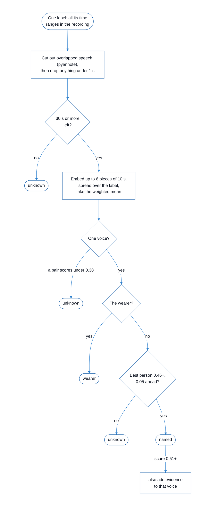

- **Why cut out overlap.**
  - What is left after the cut is called clean speech in the rest of this document: one voice at a time.
  - Overlapped speech mixes two voices into one embedding.
  - In the build, 2.9% of overlapped utterances got the wrong name, against 0.1% of clean ones.
  - The vendor gives each word one speaker, so its labels cannot show overlap.
  - So the service finds overlap itself, with the pyannote segmentation-3.0 model (open source, CPU).
- **Why pieces, not one embedding.**
  - One embedding of all the speech cannot show that a label holds two people.
  - Several pieces can be compared with each other. If two of them disagree, the label probably holds two people (the one-voice check).
  - The pieces come from across the recording, not just the first minute, so a second person anywhere in the label shows up.
- **The wearer.**
  - They record 60 seconds of their own voice on the wearable at setup, so their voiceprint matches the near-field microphone.
  - The wearer's label is never matched against anyone else.
- **Named people.**
  - Only the people this wearer named, in this account: a few hundred dot products at most.
  - If two labels both pass for the same person, diarization probably split that person, so both keep the name.
- **What is saved.**
  - Each decision and score go to the label's `SPEAKER` row.
  - No embedding of an unknown label is stored. If the wearer names it later, the service embeds it again from the audio, which is kept for 30 days.
- **Two jobs never change one voice at once.**
  - The problem: two jobs for the same wearer, such as two recordings processed at once, or a recording and a correction, can both read Priya's voice, each change it, and the second write erases the first.
  - The fix: reading, matching and writing take a Postgres advisory lock on the wearer's id, so jobs for one wearer take turns.
  - The lock lasts milliseconds. Embedding, the slow part, runs before it, so many recordings of one wearer still embed in parallel.

### 4.4 How voices are learned

Only the wearer records a voice sample on purpose, at setup (section 4.3).

Other people never set anything up. The system keeps a voice for someone only after the wearer names them in a recording.

How a voice is created, learns and is deleted:

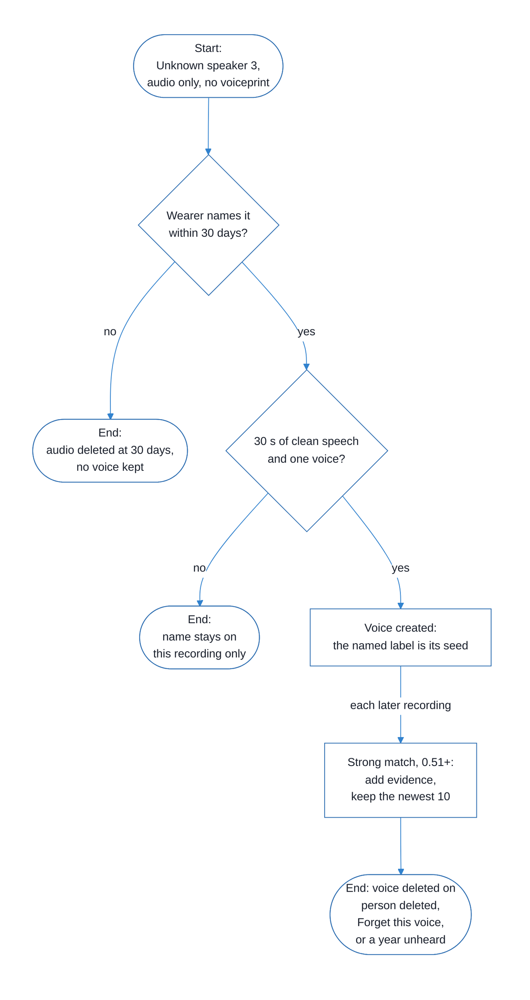

- **The gates** are 30 seconds of clean speech and the one-voice check (section 4.3), so a noisy, short or merged label cannot teach the system a wrong voice. The naming flow is in scenario 5.
- **Learning is slow on purpose.** The seed is never evicted. Automatic evidence needs at least 30 seconds of clean speech and a score of 0.51, which is 0.05 above the name threshold, and a voice keeps only its newest 10 contributions of up to 60 seconds. The voiceprint is the duration-weighted mean of the seed and those pieces, so it follows a voice that changes with a cold or a new room, while one bad match cannot take it over.
- **Corrections** move a label's evidence from one voice to another in one transaction (scenario 7).

### 4.5 Storage and deletion

Every deletion reaches each store that holds the data:

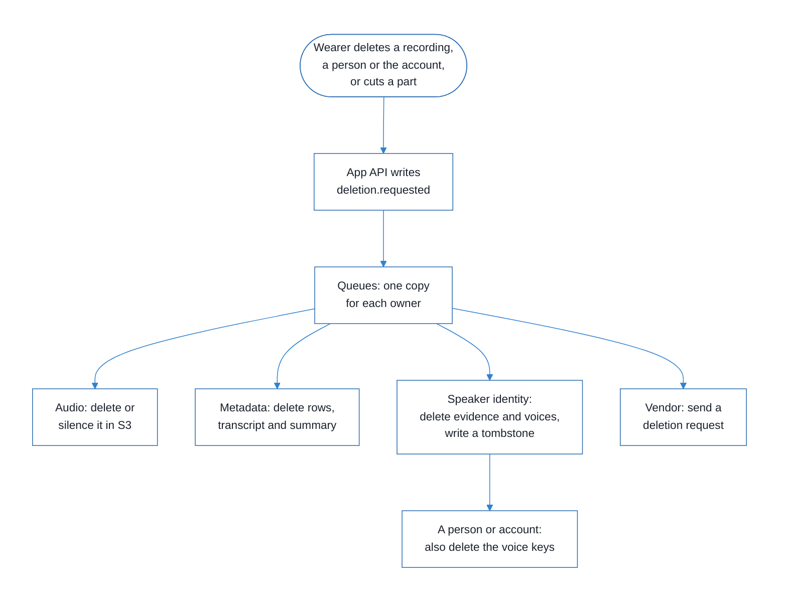

- **Each voice has its own key.** Voices are encrypted with AES-256-GCM, each under its own key. The keys sit in a separate DynamoDB table, and only the identity service can unwrap them, through KMS.
- **Deleting the key deletes every copy.** Database backups still hold the encrypted voice, but once its key is gone and the key table's 7-day recovery window passes, nothing can read them.

### 4.6 What the build measured

The build ([build/README.md](../build/README.md)) tests this matching on 16 people from the AMI meeting corpus, through one table microphone. Four of them are never enrolled and act as strangers, and a noisy copy adds other people talking nearby.

| Audio | Names shown that are right | People named | Strangers left unnamed |
|---|---|---|---|
| Quiet room | 100% | 93% | 100% |
| Others talking, 5 dB quieter | 100% | 50% | 100% |
| Others talking, just as loud | 100% | 10% | 100% |

- **No wrong names, even in noise.** Noise costs names, not correctness.
- **Where the numbers come from:**
  - 0.46: each half of the people picked its own threshold in each noise condition, and 0.46 is the strictest of those picks.
  - 0.38 rejects only 2 of 30 real one-person labels in a quiet room.
  - 30 seconds of speech was enough to enroll everyone; with 10 seconds, enrolled people were named only 89% of the time.
- **16 people is a small test,** so the rate of wearer corrections in production tunes 0.46.

### 4.7 Attribution in summaries

The language model receives segments with their ids and speaker decisions, and returns structured claims: commitments, decisions, disagreements and open questions. The owner is the person who must act, a speaker or someone named in the text ("Sam will send the deck"). Every claim passes these checks before it is shown:

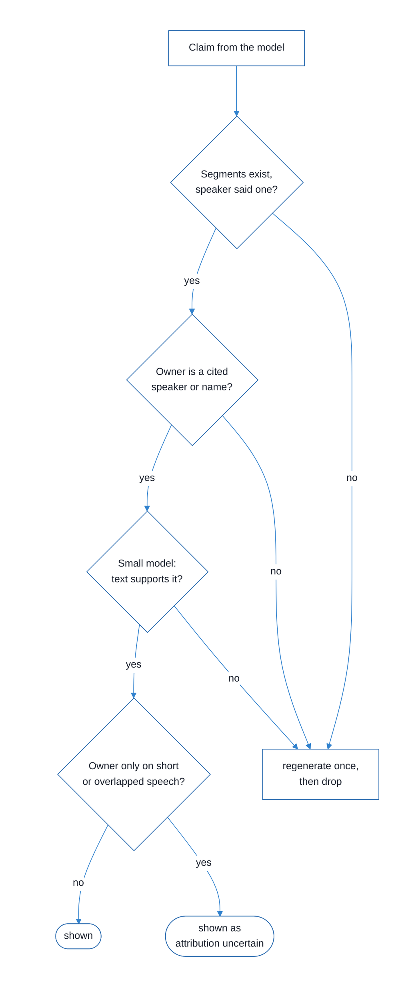

- **The small model** is Claude Haiku 5.5, about $0.002 per recorded hour. It catches "Dan, can you do the 14th?" followed by Dan's "Sure", which supports Dan, not the person who asked.
- **What can still slip through:** most likely a short or overlapped segment given to the wrong label at a turn boundary. That is why a claim resting only on such speech is shown as uncertain.
- Every claim links to its segment, and to its audio for 30 days. Claims are keyed by segment, not by name, so a correction re-runs only this step.

### 4.8 Limits

- **Small test.** 16 people, with enrollment and test in the same room and week, on a table microphone, without Opus compression. The noise is other people talking, not music or wind.
- **Larger rosters.** The test had 12 voices; a real wearer may have hundreds. Score normalization (adaptive s-norm) is the next experiment.
- **No real diarization.** The build used the corpus's own speaker turns and overlap marks, and dropped whole overlapped utterances.

## 5. Scenarios

**1. Dinner at a restaurant.**
- Overlapped speech is cut out before matching, so most labels stay "Unknown speaker" instead of getting a wrong name (section 4.3).
- Nobody at the louder table was named by the wearer, so no voiceprint of them is kept.
- The vendor skips music, but music lowers diarization quality, so fewer labels pass.
- In the build, talkers as loud as the speaker cut names to 10% of enrolled people's labels, with none wrong (section 4.6).
- The wearer can name the rest by hand.

**2. Someone says "please don't record this."** A cut deletes the part from every store once.
- **Double-press:** the wearable deletes the last five minutes and pauses. Chunks already uploaded are deleted by the API before processing.
- **The wearer does nothing:** the redact step finds the request in the transcript, before speaker identity, and silences the audio until the recording stops or someone says recording is fine again.
- **Cut later by hand:** `deletion.requested` reaches every store (section 4.5). A tombstone stops a naming already in progress from saving evidence from the cut (diagram below).
- The app tells the wearer that a part was cut and why.

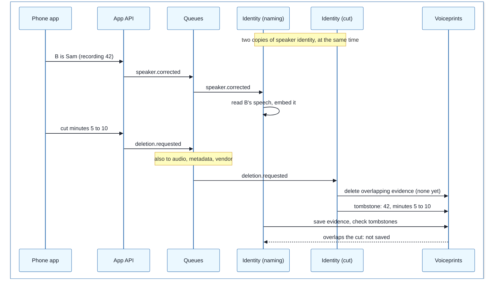

**3. Offline for nine hours, then reconnect.**
- Nine hours of Opus is about 100 MB, which fits on the wearable.
- The phone transfers the oldest recording first: about 17 to 19 minutes over Bluetooth LE at 90 to 100 KB/s (diagram in section 3.5).
- Each recording is processed as soon as its chunks are in, and the queues absorb the burst.

**4. Two colleagues wear devices in the same meeting.**
- Each device records and processes in its own account. Nothing is shared, voiceprints included.
- Each wearer is the near-field voice on their own device, which the wearer check uses (section 4.3).

**5. Someone new says something that matters.**
- They show as "Unknown speaker 3". The audio is kept for 30 days, so the wearer can name them later.
- If the label passes the gates, the naming starts their voice, and later recordings name them automatically (section 4.4).

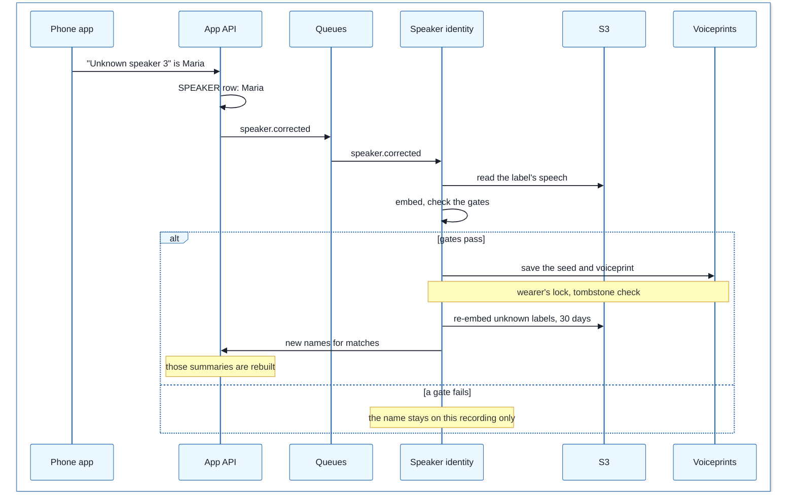

**6. The device is lost.**
- The wearable holds no key that can decrypt its stored recordings, so nobody can read the audio on it.
- Once the wearer marks it lost, the API rejects its chunks.
- Audio that was never synced is lost with the device.

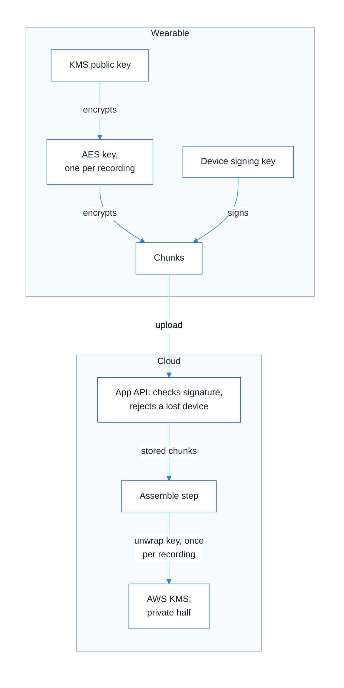

**7. A commitment goes to the wrong person.**
- **Prevention:** the identity checks (section 4.3), the gates for learning a voice (section 4.4) and the claim checks (section 4.7).
- **Repair:** the wearer reassigns the speaker, and every summary that cites the label is rebuilt (diagram below).
- The rate of these corrections is the live measure of name accuracy, and it tunes the threshold.

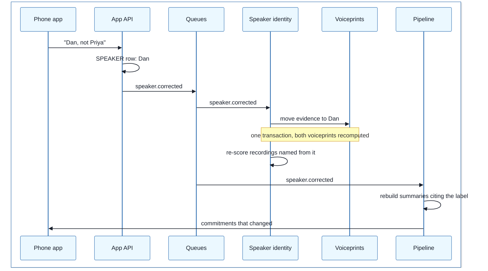

## 6. Alternatives considered

| Alternative | Why not |
|---|---|
| Speaker identity on the phone | battery and heat, and every voiceprint is lost with the phone |
| Vendor speaker identification | a vendor would hold voiceprints of people who never signed up |
| Voiceprints for people nobody named | biometric data of strangers, such as the next table |
| One identity per person across all users | a way to track people who never signed up |

## 7. Privacy and biometric data

- **The law.** Voiceprints are biometric identifiers under Illinois BIPA, Texas and Washington law and GDPR.
- **Region policy.** Where a person's own consent is required before a voiceprint is collected, recognition of other people is off, and the wearer names speakers by hand.
- **Naming is the wearer's choice,** not the other person's consent. The app says the voice will be recognized later, and offers "Forget this voice" on every person.
- **No cross-account identity.** A voice never leaves one wearer's account.
- **Retention.**
  - Raw audio: 30 days after processing.
  - Decrypted audio: only the assemble step can decrypt. Its file is deleted once speaker identity has read it, and a later read, such as naming a label, asks the assemble step for a new short-lived file.
  - Voices: until the wearer deletes the person, or after a year unheard.
- **Vendors** get audio under a no-retention, no-training agreement, and never get voiceprints.
- **A light on the wearable** shows when it is recording.
